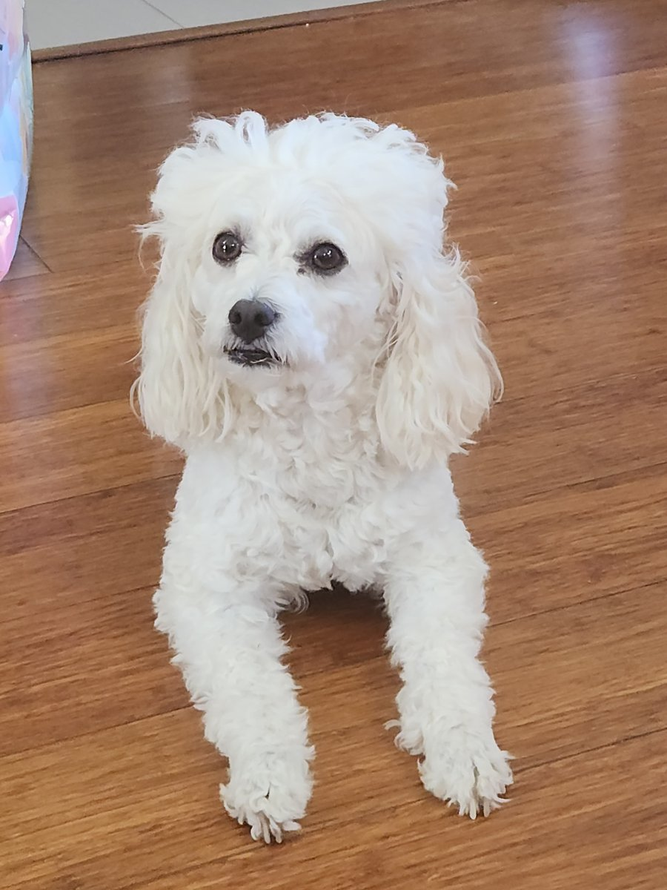
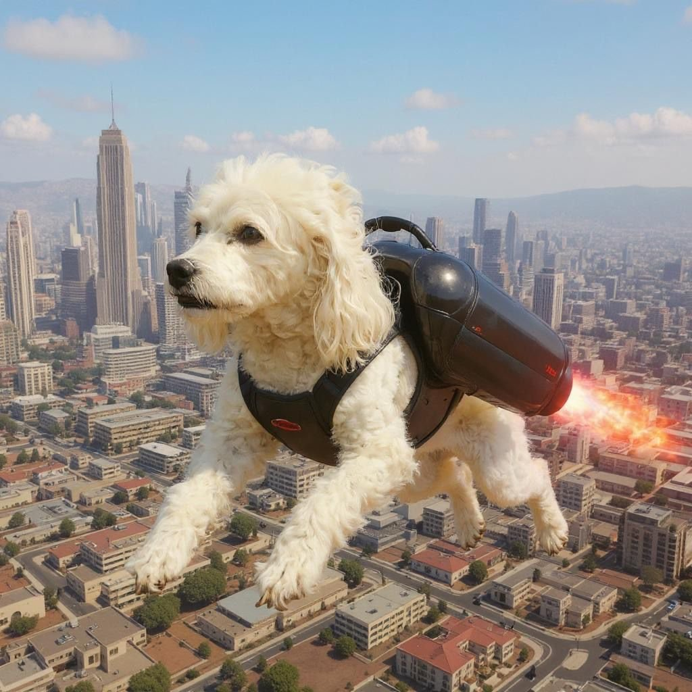
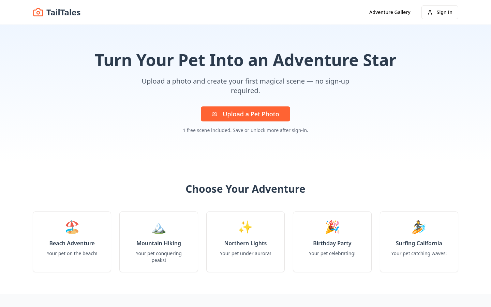
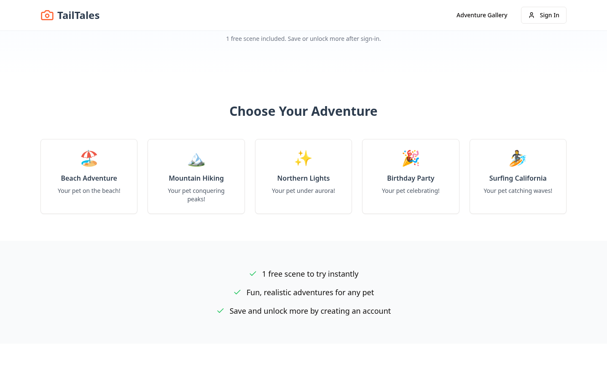
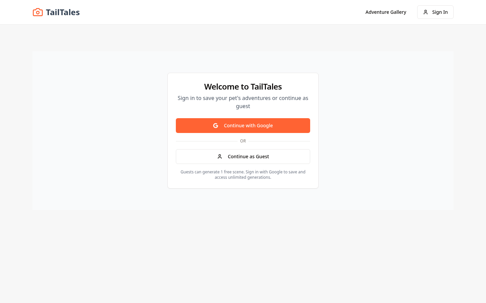
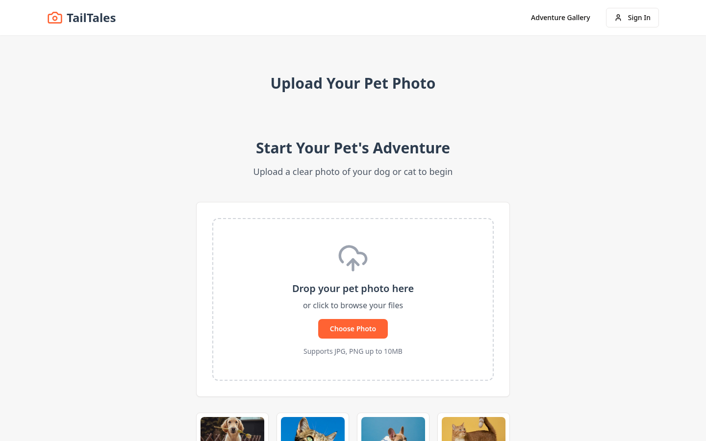
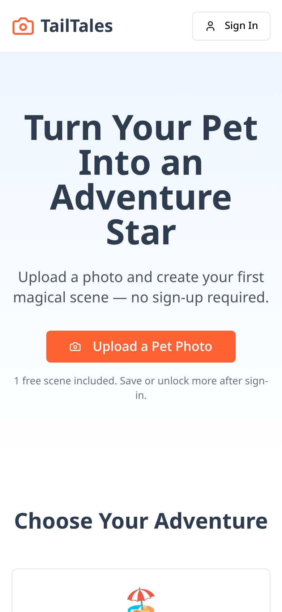

# TailTales

**Upload a photo of your pet and turn it into an AI-generated adventure scene.**

> **Status:** Fully built web application, not publicly launched. Source code is private; available on request.

**Timeline:** Project, 2025

## Before / After

One uploaded photo of a pet, and two of the adventure scenes generated from it.

| Original photo | Scene: Jetpack over the city | Scene: Graduation day |
|---|---|---|
|  |  |  |

## Screenshots

**Landing page**

**Choose your adventure**

**Sign in with Google or continue as a guest**

**Photo upload**

**Mobile**

## Key features

- **Photo upload:** drag and drop or browse for a clear photo of a dog or cat (JPG or PNG, up to 10 MB).
- **Choose an adventure scene:** pick from a set of themed scenes such as Beach Adventure, Mountain Hiking, Northern Lights, Birthday Party and Surfing California.
- **AI-generated scenes** created with Replicate image models from the uploaded photo.
- **Google or guest sign-in** through Firebase Authentication.
- **1 free scene** with no sign-up required to try it.
- **Gallery** of generated scenes, kept for signed-in users.
- **Stripe checkout integration** for unlocking more scenes (built, not activated).

## Tech stack

From the project's `package.json`:

- **Frontend:** React 18, Vite, TypeScript, Tailwind CSS, Radix UI components, TanStack Query, Framer Motion
- **Backend:** Node.js with Express, Multer for uploads, Sharp for image handling
- **Authentication:** Firebase Auth (Google and anonymous guest sign-in)
- **Database:** Neon serverless Postgres with Drizzle ORM
- **AI image generation:** Replicate
- **Payments:** Stripe (integration built, not activated)
- **Built on:** Replit

## My role

Product idea, design and full-stack build by Bakhytzhan Ibrayev.

## Source code

The source code is private and is not included in this repository. It is available on request.
